# 检测框整体往左上偏，根子在 DFL 和坐标共用了一套刻度

> 2026-11-02。框偏移的成因与修复过程，涉及 INT8 量化、DFL 与 RKNN。

`head` 指模型的检测头，也就是输出检测结果的最后一段网络。YOLOv8 的检测头在 ONNX 图里节点名前缀是 `/model.22/`，官方只叫 `Detect` head。

`head2` / `head3` / `head4` 这三个编号是本项目自定的，不是官方术语。三个版本的关系：

| 名称 | 对检测头做了什么 | 结果 |
|---|---|---|
| 原始 | 无改动（ultralytics 导出原样） | 只有 1 个输出，INT8 转出来分数全 0 |
| head2 | 末端加一个 `Split` 把输出拆成两路 | 触发 RKNN 工具 bug，分数变 0 |
| head3 | 改成删掉末端 `Concat`，两路直接当输出 | 可用，但框偏 6.75 px |
| **head4** | 再删掉 DFL 之后的 9 个换算节点，输出距离 | **可用，框偏 0.03 px** |

head4 这个名字指的是「输出 DFL 距离而非坐标」的那版模型。按特性称呼即可。

---

# 目录

| 章 | 讲什么 |
|---|---|
| 〇 | **一页看完**（赶时间只看这页） |
| 一 | **修复前后的框对比**（同一辆车，旧框与新框） |
| 二 | **量化是什么**（为什么模型要压缩） |
| 三 | **刻度是什么**（为什么刻度粗细决定精度） |
| 四 | **问题出在哪**（两套量纲共用一把尺子） |
| 五 | **误差怎么放大**（一步错，步步放大） |
| **五点五** | **三种模型的输出长什么样**（单输出 vs 双输出） |
| **五点六** | **输出张量的选择原理**（为什么可以指定） |
| 六 | **怎么发现的**（4 个通道的证据） |
| 七 | **怎么修的**（改了什么） |
| 八 | **怎么验证的**（三道关） |
| 九 | **为什么比混合量化好** |
| 十 | **速查表** |

> 改动内容见第七章，输出张量的选择原理见五点六节。

---

# 〇、一页看完

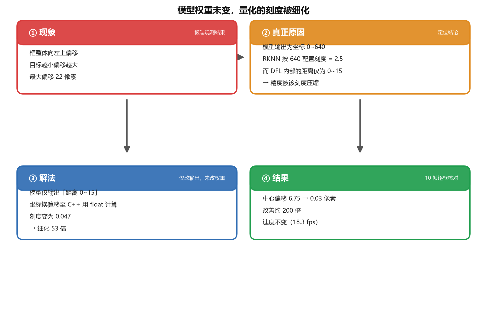

模型权重一个字节没变，变的是量化刻度的粗细。

| 项目 | 数字 |
|---|---|
| 修之前，框中心偏 | 6.75 像素 |
| 修之后，框中心偏 | **0.03 像素** |
| 改善 | 约 200 倍 |
| 速度 | 18.3 fps → 18.3 fps（**没变**） |
| 量化方式 | INT8 → INT8（**没变**） |
| 校准集 | 300 张 → 300 张（**没变**） |

---

# 一、修复前后的框对比

原理往后放，先看图。

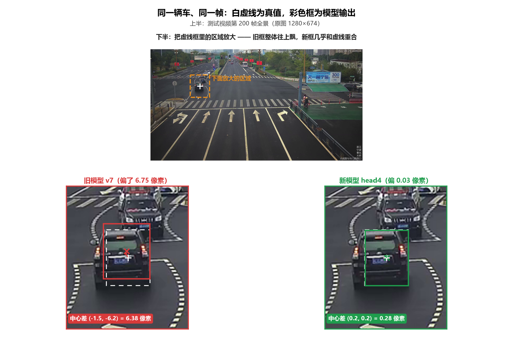

三种线各自代表什么：

- **白虚线**：最准的位置。PC 上跑 FP32 模型得到，不量化，没有误差
- **红框**（左）：旧模型给的，比虚线整体往上飘了一截
- **绿框**（右）：新模型给的，几乎和虚线重合

同一辆车、同一帧、同一份权重，只是模型输出的东西换了。

---

# 二、量化是什么

## 2.1 为什么要把模型压小

模型里有几千万个小数，叫权重。一个用 4 字节存，整个模型就几十 MB。

量化就是把这些小数换成 1 字节的整数：

```
模型体积小 4 倍
跑得也快很多
```

代价是精度会损失。这是量化的本质，拿精度换体积和速度。

## 2.2 换算是怎么做的

用一个固定公式：

$$
\text{真实值} = (\text{整数} - \text{零点}) \times \textbf{刻度}
$$

| 名词 | 是什么意思 |
|---|---|
| **整数** | 存下来的那个数，1 字节，范围 −128 ～ 127，**共 256 个格子** |
| **零点** | 一个偏移量，本模型中为 −128 |
| **刻度**（scale） | **最关键——一个格子代表多少** |

反过来的公式：

$$
\text{整数} = \frac{\text{真实值}}{\textbf{刻度}}
$$

---

# 三、刻度是什么

## 3.1 只有 256 个格子

格子数恒为 256 个，不随数据范围变化。

能变的只有一件事：这 256 个格子要覆盖多大的范围。

```
刻度 = 范围上限 / 256
```

## 3.2 范围越小，越准

| 要表示的范围 | 刻度 | 一格代表 | 最大误差 |
|---|---|---|---|
| 0 ～ 640（坐标） | 640/256 = **2.5** | 2.5 像素 | ±1.25 像素 |
| 0 ～ 15（距离） | 16/256 = **0.047** | 0.047 | ±0.023 |

同样是 256 个格子，装的东西范围越小，每格越细，就越准。

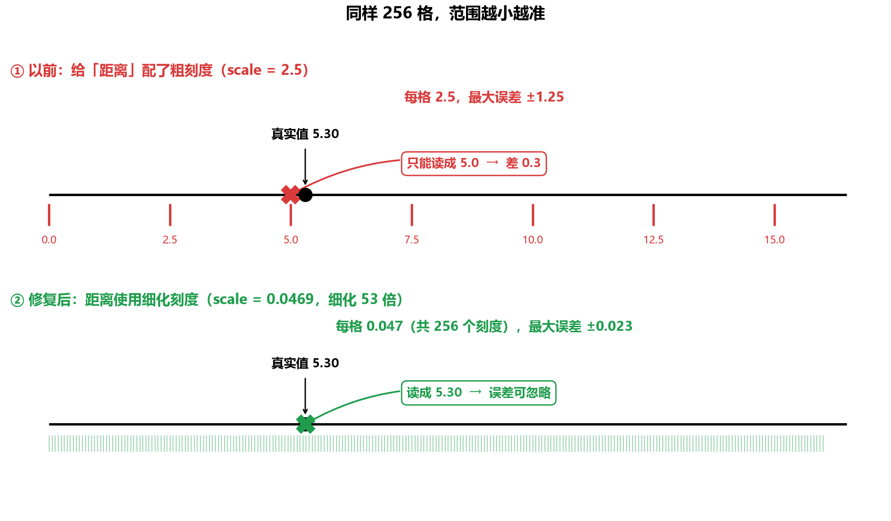

一格 2.5 的那把，量 5.30 只能读成 5.0。一格 0.047 的那把，量 5.30 还是 5.30。

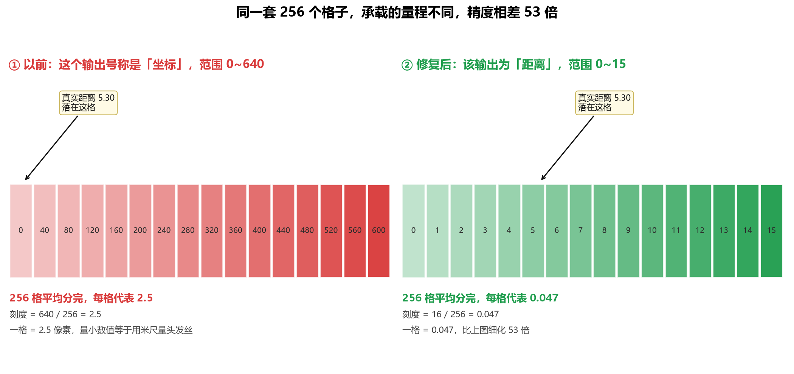

差别到这里就全了。同样是 256 个格子：

- 左图：格子被摊在 0～640 上，一格跨 2.5，小数值全被压扁
- 右图：格子集中在 0～15 上，一格跨 0.047，小数值精准

---

# 四、问题出在哪

## 4.1 YOLOv8 的框是怎么算出来的

DFL 全称 Distribution Focal Loss。YOLOv8 不直接说「框的左边在哪」，它输出的是一个概率分布：

```
框的左边到锚点的距离，可能是 0 格、1 格、2 格 ... 15 格
DFL 给这 16 个可能各算一个概率
最后取加权平均 = 这条边到底有多远
```

所以 DFL 算出来的东西叫「距离」，单位是格子数，范围 0 ～ 15。

## 4.1.1 为什么是 0～15，不是 0～16

从模型里读出来的那个权重就是答案（`tools` 里能直接查）：

```
model.22.dfl.conv.weight = [0, 1, 2, 3, 4, 5, 6, 7, 8, 9, 10, 11, 12, 13, 14, 15]
```

16 个数，编号 0 到 15。加权平均就是拿这 16 个数去乘概率再求和，所以：

```
最小可能：概率全压在 0 上   → 距离 = 0
最大可能：概率全压在 15 上  → 距离 = 15
```

> 「DFL 有 16 个 bin」指的是格子数量为 16，值域上界为 15，两者不同。

实测印证：真实视频第 200 帧，距离的实际取值范围是 0.02 ～ 10.7，从没接近 15。

这对方案没有影响。RKNN 自己量出来的是 11.97，配的刻度是 0.0469，比按 15 估算的 `15/256 = 0.0586` 还更细一点。

## 4.2 距离怎么变成坐标

拿到 4 个距离（左、上、右、下）以后，还要再算一步：

```
x1 = 锚点x − 左距离
x2 = 锚点x + 右距离
再乘 stride（8 / 16 / 32）
= 0 ~ 640 的像素坐标
```

这一步原来是在模型里的，对应模型末尾的 9 个节点。

## 4.3 两套量纲共用一把尺子

问题就在这里。

模型最后输出的是坐标，范围 0～640。RKNN 拿到这个输出，看到范围是 640，于是：

```
刻度 = 640 / 256 = 2.5
```

但 DFL 内部的距离只有 0～15。

它被迫在这把「一格 2.5」的粗尺子上表示，结果：

```
距离 5.30  →  最多只能表示成 5.0  →  误差 0.3 格
```

粗尺子量细数值，精度就这么没了。

## 4.4 为什么「车越小、越远，偏得越厉害」

误差是固定的，约 ±1.25 像素，但远处车的框本身就小，可能只有 20 像素宽。

```
固定的误差 ÷ 小的框 = 大的相对误差
```

看起来就像「越远越偏」。

---

# 五、误差怎么放大

0.3 格的误差，怎么会变成 6.75 像素？这是最容易卡住的地方。

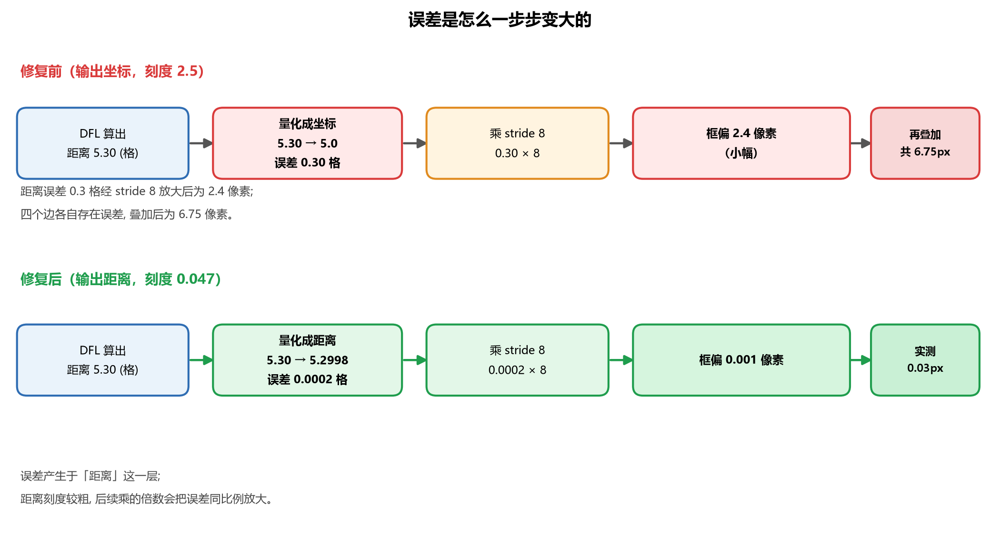

以前那条路径：

```
距离 5.30
  ↓ 量化成坐标（刻度 2.5）
5.0，误差 0.30 格
  ↓ 乘 stride 8
2.4 像素
  ↓ 框的四个边各错一点，中间再叠加
6.75 像素
```

现在这条：

```
距离 5.30
  ↓ 量化成距离（刻度 0.047）
5.2998，误差 0.0002 格
  ↓ 乘 stride 8
0.0016 像素
  ↓ 实测
0.03 像素
```

关键在于误差是在「距离」这一层产生的。距离的刻度粗，后面乘多少倍，误差就跟着放大多少倍。

## 5.1 完整刻度链

前面那张图是简化的示意。真实模型里那 9 个算子每一步都会重新量化一次，每一步的刻度都是拿「这一步算出来的值域」重新算的。

从 step1 生成的 `quantization.cfg` 里读出来的真实数据：

| 步骤 | 算子 | 值域 | 刻度 |
|---|---|---|---|
| ① | DFL 输出距离 | 0 ～ 11.97 | **0.047** |
| ② | anchor − 左距离 | −3.47 ～ 79.46 | 0.325 |
| ③ | anchor + 右距离 | 0 ～ 83.28 | 0.327 |
| ④ | 两者相加 ÷ 2 | 0 ～ 159.48 | 0.625 |
| ⑤ | 两者相减 = 宽高 | 0 ～ 21.43 | 0.084 |
| ⑥ | 拼成 4 通道 × stride | 0 ～ 637.92 | **2.502** |

刻度从 0.047 一路被撑到 2.50，放大约 53 倍。

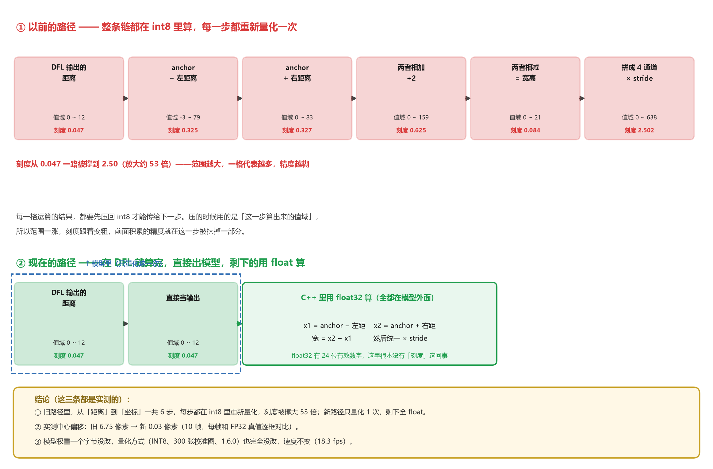

### 为什么会一步步变粗

关键在第 ② 步：

```
anchor  （0.5 ~ 79.5，大数）
   −
左距离  （0 ~ 12，小数）
   =
结果    （−3.5 ~ 79.5）
```

相减之后，结果的范围被那个大数主导了。原本 0～12 的精度，被塞进一个 0～79 的范围里，精度立刻被稀释约 7 倍。

后面每一步又乘又加，范围继续涨，刻度继续粗，一直到最后 2.5。

### 所以 head4 到底修好了什么

修的不只是「最后配了个细刻度」，而是「后面那 5 次量化全都不发生了」。

```
模型里的路径：int8 → int8 → int8 → int8 → int8 → int8   （6 次量化）
C++ 里的路径：float32 一路到底                            （0 次量化）
```

float32 有 24 位有效数字，这里根本没有「刻度」这个概念。

---

# 五点五、三种模型的输出长什么样

这个问题容易绕晕，一次说清。

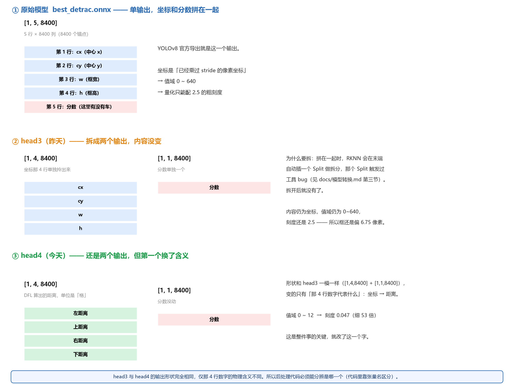

| | 输出形状 | 那 4 行代表什么 | 值域 | 刻度 |
|---|---|---|---|---|
| **原始 ONNX** | `[1, 5, 8400]` 一个输出 | cx cy w h + 分数 | 0～640 | 2.5 |
| **head3** | `[1,4,8400]` + `[1,1,8400]` 两个 | cx cy w h | 0～640 | 2.5 |
| **head4** | `[1,4,8400]` + `[1,1,8400]` 两个 | 左 上 右 下 距离 | 0～12 | **0.047** |

## 为什么 head3 要拆成两个输出

原始模型把坐标和分数拼在一个张量里。RKNN 转换时会在末端自动插一个 `Split` 做拆分。

那个 `Split` 触发过工具 bug（详见 [模型转换.md](模型转换.md) 第三节）：

- 1.6.0：分数的 8400 个 int8 全变成 −128（= 0）
- 2.5.0：分数正常，但框塌了

拆成两个独立输出后就没有这个问题。

## head3 与 head4 的形状相同

```
head3: [1,4,8400] 存的是 cx cy w h
head4: [1,4,8400] 存的是 左 上 右 下 距离
```

形状一样，含义不同。后处理代码必须能分辨是哪一个。`rknn_detector.cpp` 里靠张量名有没有 `dfl` 来判断：

```cpp
// head4: /model.22/dfl/Reshape_1_output_0   -> 含 "dfl"
// head3: /model.22/Mul_2_output_0           -> 不含
impl_->boxes_is_dist = std::string(a.name).find("dfl") != std::string::npos;
```

因此 v7（head3）与 head4 可以互换，代码无需改动。

---

# 五点六、输出张量的选择原理

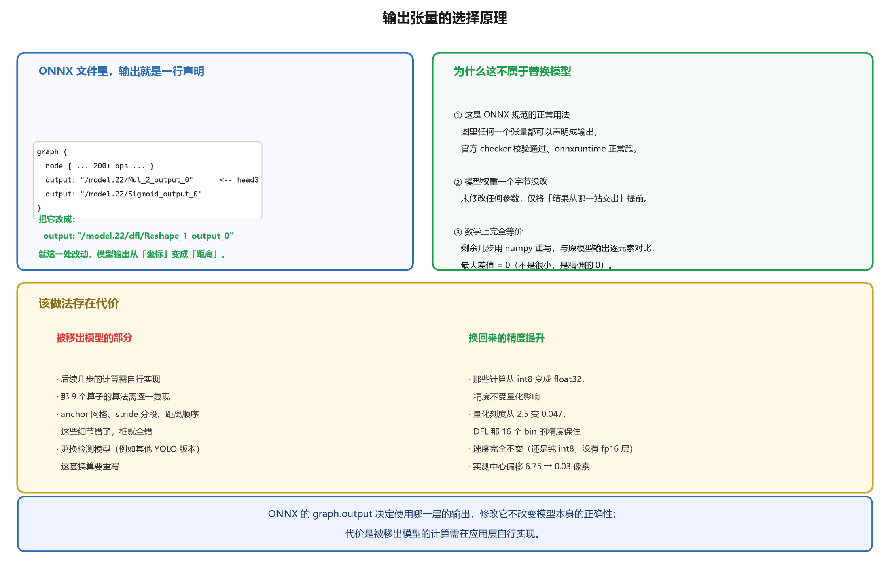

## ONNX 文件里，输出就是一行声明

```python
graph {
  node { ... 200+ ops ... }
  output: "/model.22/Mul_2_output_0"        # head3 写这行
  output: "/model.22/Sigmoid_output_0"
}
```

改成：

```python
  output: "/model.22/dfl/Reshape_1_output_0"   # head4 写这行
```

就这一处改动。

## 与「替换模型」的区别

| | |
|---|---|
| **ONNX 规范** | 图里任何张量都可以声明成输出。`onnx.checker` 校验通过，onnxruntime 正常跑。 |
| **模型权重** | 未做任何修改，仅改变输出层的选取位置。 |
| **数学等价** | 剩下那几步用 numpy 重写，和原模型输出逐元素对比，**差值精确等于 0**。 |

输出内容由坐标变为距离，这个变化在 ONNX 规范内，也可以验证。

## 代价

- 后面那几步的代码得自己写
- 那 9 个算子的算法要自己复刻对（anchor 网格、stride 分段、距离顺序，错一个就全错）
- 换成别的检测模型，这套换算要重写

换来的是：那些计算从 int8 变成 float32，精度不再受量化影响，速度不变。

---

# 六、怎么发现的

前面这些是梳理清楚之后的说法。当时是从零开始查的。

## 6.1 一开始猜错了方向

初始判断是「DFL 的 16 个 bin 精度不足」，于是去试混合量化，把 DFL 那几层改成 fp16。

试了整整一天，两个工具版本都失败。方向错了，怎么调都没用。

## 6.2 转折点：看 4 个通道的范围

最后换了个思路：别猜了，直接看数字。

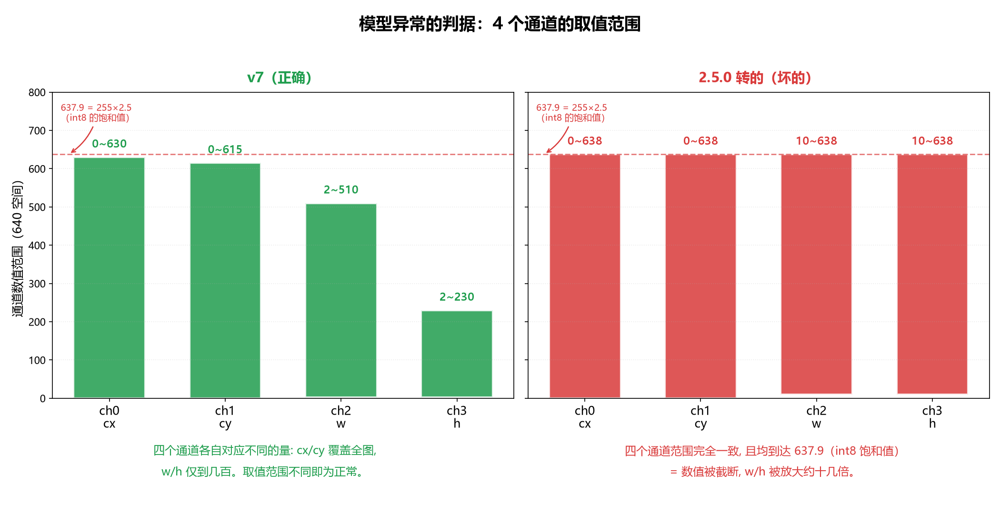

模型的 boxes 输出是 4 个通道：`cx / cy / w / h`（中心x、中心y、宽、高）。

正常模型里，这 4 个通道各管一件事，范围应该各不相同：

```
ch0 cx : 0 ~ 630      ← 横坐标，覆盖全图
ch1 cy : 0 ~ 615      ← 纵坐标，覆盖全图
ch2 w  : 2.5 ~ 510    ← 框的宽，最大也就一半图宽
ch3 h  : 2.5 ~ 230    ← 框的高，更小
```

坏掉的模型，4 个通道范围一模一样：

```
ch0 cx : 0 ~ 637.9
ch1 cy : 0 ~ 637.9
ch2 w  : 10 ~ 637.9
ch3 h  : 10 ~ 637.9
```

## 6.3 决定性证据

看那个数字：637.9

```
637.9 ≈ 255 × 2.5 = 638
        ↑     ↑
     int8 最大值  刻度
```

这是 int8 可表示的最大值，也就是饱和值，超出该值的部分被截断。

同一辆车的具体数值：

| 模型 | cx | cy | **w** | **h** |
|---|---|---|---|---|
| v7（正确） | 160.1 | 215.1 | **20.0** | **20.0** |
| 2.5.0 转的（坏） | 120.1 | 195.1 | **235.2** | **260.2** |

w/h 被撑大了 13 倍。

所以「框偏左上」这个描述并不准确。实际是框被撑大了，撑大之后中心随之偏移。

---

# 七、怎么修的

## 7.1 核心思路

别再让 RKNN 自己猜范围，直接把「距离」当输出。

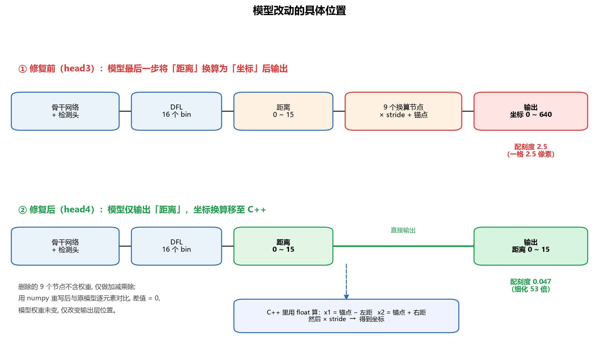

一旦「距离」成为模型的输出，它就是一个独立的张量，RKNN 必须单独给它配刻度，而且会按它真实的 0～15 来配：

```
16 / 256 = 0.047    ←  比 2.5 细了 53 倍
```

那 9 个换算节点，从模型里删掉，搬到 C++ 里用 float 算。

## 7.2 具体改了什么

新建了一份 ONNX，原文件一个字节没动。

```
models/best_detrac.onnx        原始模型（没动）
models/best_detrac_head3.onnx  昨天那份（删了末端 Concat）
models/best_detrac_head4.onnx  今天这份（再删掉坐标换算的 9 个节点）
```

改动只有两步：删掉 DFL 之后的那 9 个节点，再把中间张量 `/model.22/dfl/Reshape_1_output_0` 设成图的输出。

这 9 个节点是 `Slice ×2`、`Sub ×2`、`Add ×2`、`Div`、`Concat`、`Mul`。它们没有任何权重，只是纯加减乘除。

> 模型本身未变，只是把最后一步换算从模型内移到了程序中。

## 7.3 C++ 里怎么算

```cpp
// 每帧 8400 次，纯 float 运算，耗时可以忽略
x1 = (anchor_x - 左距离) * stride;
y1 = (anchor_y - 上距离) * stride;
x2 = (anchor_x + 右距离) * stride;
y2 = (anchor_y + 下距离) * stride;
```

三个容易踩的细节：

| 东西 | 规格 |
|---|---|
| **anchor 网格** | 三段：80×80、40×40、20×20，值 = (列号+0.5, 行号+0.5) |
| **stride** | **是 8400 长的数组，不是标量。** 前 6400 个 = 8，中 1600 个 = 16，后 400 个 = 32 |
| **距离顺序** | 左、上、右、下 |

> **实际遇到的问题**：最初假定 stride 固定为 8，直接 `× 8`。
> 结果后两段全错，最大差 **453 像素**。后来从 ONNX 的 `Constant_15` 里读出来才发现是个数组。

## 7.4 代码怎么自动识别新旧模型

```cpp
// 看坐标输出的张量名里有没有 "dfl"
//   head4: /model.22/dfl/Reshape_1_output_0   -> 有，走距离换算
//   head3: /model.22/Mul_2_output_0           -> 没有，直接用坐标
impl_->boxes_is_dist = std::string(a.name).find("dfl") != std::string::npos;
```

因此 v7 与 head4 可以互换，代码无需改动。换回旧模型时替换 `models/best_detrac.rknn` 即可。

---

# 八、怎么验证的

改模型最怕「改坏了还以为改好了」。所以设了三道关，每道都是硬指标，过了才往下走。

## 第一关：结构对不对

ONNX 必须合法，`onnx.checker.check_model()` 要通过。更关键的是分数输出必须和原模型逐元素完全相同，差值必须是 0。

分数输出本来没做改动，它的数值一旦变了，就说明切割位置选错了。

> 实际结果：**差值 = 0**。距离范围 0.02 ～ 10.7，落在合理的 0～15 内。

## 第二关：换算公式对不对

用 numpy 把 C++ 要做的换算重写一遍，和原模型的输出逐元素对比。

> 实际结果：**最大差值 = 0**。

## 第三关：板子上跑，到底准不准

这是最硬的一关。先在 PC 上用 FP32 ONNX 跑同一帧当真值，不量化，最准；再让板子分别跑 v7 和 head4；接着按 IoU 把检测框和真值配对；最后算每个框的边缘误差。

跑了 10 帧，每帧逐框对比：

| | 左边缘 | 上边缘 | 中心偏移 |
|---|---|---|---|
| v7（旧） | −4.94 | −5.50 | **6.75** |
| head4（新） | +0.04 | −0.00 | **0.03** |

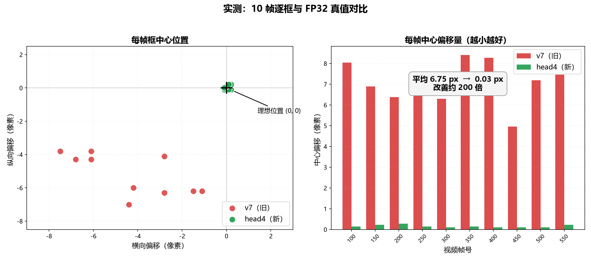

图的左边是每帧的中心偏移位置，红点（旧）都在左下，绿点（新）全挤在原点。右边是每帧偏了多少，红柱子 6～8 像素，绿柱子几乎看不见。

10 帧全部稳定，不是某一帧碰巧。

---

# 九、为什么这条路比混合量化好

混合量化是官方给的另一条路，思路是让 DFL 那几层用 fp16（不量化），其余还是 int8。

理论上也对，实际卡住了：

| 工具版本 | 结果 |
|---|---|
| 1.6.0 | step2 崩 `KeyError: '/model.22/Concat_1_output_0'`，改配置绕不过 |
| 2.5.0 | **连普通 INT8 都转坏了**，轮不到混合量化上场 |

head4 这条路好在哪：

| | 混合量化 | head4 |
|---|---|---|
| 依赖什么 | 工具的内部行为 | **模型结构，完全可控** |
| 风险 | 工具一升级/一改 bug 就崩 | 结构不变就一直有效 |
| 速度 | 部分层变 fp16，会慢一点 | **不变**（全是 int8） |
| 可验证性 | 只能看最终效果 | **每一关都能硬指标验证** |

混合量化依赖工具的内部行为，head4 把控制权交回模型结构。

---

# 十、速查表

## 10.1 关键数字

| 项目 | 数值 |
|---|---|
| 旧的刻度 | 2.5017 |
| 新的刻度 | 0.046943 |
| 细了多少倍 | 53 |
| 旧的中心偏移 | 6.75 px |
| 新的中心偏移 | 0.03 px |
| 改善了 | 约 200 倍 |
| 速度 | 18.3 fps（不变） |
| stride 分段 | 8（6400个）/ 16（1600个）/ 32（400个） |

## 10.2 判断模型好坏

```bash
./rknn_probe 模型.rknn data/videos/test1.mp4 200
```

看这几行：

| 看什么 | 好的样子 | 坏的样子 |
|---|---|---|
| `[OUT1 int8]` 的 `==zp(-128)` | ≈ 8340 | 8400（分数全 0） |
| `[OUT0]` 的 scale | head4：0.047 | 2.5（刻度没变细） |
| 4 个通道范围 | 各不相同 | 全一样 |

## 10.3 文件清单

| 文件 | 说明 |
|---|---|
| `models\best_detrac_head4.onnx` | 改好结构的 ONNX（12.02 MB） |
| `models\best_detrac.rknn` | 转好的 INT8 模型（5.97 MB） |
| `tools\01_convert\make_head4.py` | 从 head3 生成 head4，带自动校验 |
| `tools\verify_head4_decode.py` | 验证换算公式 |
| `tools\convert_head4_probe.py` | 1.6.0 转 RKNN |
| `tools\02_diagnose\ch_scan.cpp` | 查 4 个通道范围 |
| `tools\box3.cpp` | 两模型 + 真值三方对比 |
| `tools\05_figures\draw_explain_figs.py` | 生成全部配图 |
| `src\rknn_detector.cpp` | 板子上的代码，加了 head4 分支 |

## 10.4 复现步骤

```bash
# 1. 生成 head4 的 ONNX（Windows，带自动校验）
D:\Python3.12.4\python.exe tools\01_convert\make_head4.py

# 2. 验证换算公式（必须差值为 0 才算过）
D:\Python3.12.4\python.exe tools\verify_head4_decode.py

# 3. 转 RKNN（WSL，1.6.0 环境）
conda activate rknn16
cd ~/traffic_count
python /mnt/d/multi-road-crossing-vehicle-count/tools/01_convert/convert_head4_probe.py

# 4. 传到板子验证
cd ~/code
./rknn_probe models/best_detrac.rknn data/videos/test1.mp4 200
```

---

# 十一、还没做的事

- **计数漏**（转弯车漏计）—— 项目最初的主要目标，还没动
- **混合量化** —— 官方路线，2.5.0 有 bug，1.6.0 没试通
- 老模型清理 —— `v6` / `v8_h250` / `v9_h250` / `int8_normal` 都是失败产物

---

# 最后

量化就是用 256 个格子表示小数，格子数不变，范围越小越准。

RKNN 给错了范围，把 0～15 的距离当成了 0～640 的坐标，精度于是全丢在这把粗尺子上。

把「距离」单独拿出来当输出，它就必须给出对的范围。

模型权重一个字节没改，速度一点没变。
